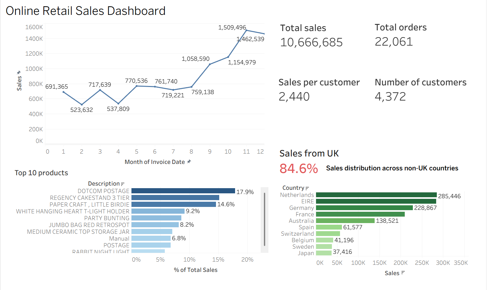

# Online Retail Sales Dashboard (Tableau)

**▶ [View the interactive dashboard on Tableau Public](https://public.tableau.com/app/profile/<your-tableau-profile>)**



## Business context
A UK-based online gift retailer sells mainly to wholesale customers across 38 countries. Management needs one page that answers: **how big is the business, where does revenue come from, and when does it peak?**

## Data
- [UCI Online Retail dataset](https://archive.ics.uci.edu/dataset/352/online+retail): 541,909 invoice lines, Dec 2010 – Dec 2011
- Fields: invoice, product, quantity, unit price, customer ID, country

## What the dashboard shows
| Section | Question it answers |
|---|---|
| KPI cards: total sales, orders, customers, sales per customer | How big is the business? |
| Sales over time (monthly) | Is there seasonality? |
| Sales across countries + UK vs. other countries | How dependent are we on the home market? |
| Top 10 products (% of top-10 sales) | Which products carry revenue? |

## Tableau techniques used
**Data cleaning in a calculated field.** Raw `Quantity × UnitPrice` includes returns (negative quantities) and zero-price adjustments, so revenue is defined as:
```
// Sales
IF [Quantity] > 0 AND [UnitPrice] > 0 THEN [Quantity] * [UnitPrice] END
```
**Customer-level KPI with a distinct count:**
```
// Sales per Customer
SUM([Sales]) / COUNTD([CustomerID])
```
**Grouping for a home-vs-export view:**
```
// Country Group
IF [Country] = "United Kingdom" THEN "United Kingdom" ELSE "Other countries" END
```
**Table calculation** for each product's share: `SUM([Sales]) / TOTAL(SUM([Sales]))`, plus a Top-N filter.

## Key findings
- **£10.7M** in sales from **4,372** identified customers across **38** countries.
- **The UK generates ~85% of revenue.** The next markets (Netherlands, Ireland, Germany, France) are each under 3%, so export growth is a clear opportunity but currently a small one.
- **Strong Q4 seasonality:** monthly sales sit around £0.69M from January to August 2011, then climb to **£1.51M in November** (≈2.2× baseline), consistent with wholesale buyers stocking up for Christmas. Inventory and staffing should be planned from September.

## Limitations and next iteration
Reviewing the data after building the dashboard, I found three issues I would fix in version 2:
1. **Non-product lines in the Top 10.** `DOTCOM POSTAGE`, `POSTAGE` and `Manual` are fees/adjustments, not products. They should be excluded with a product-type filter.
2. **Order-then-cancel outliers.** Two "top products" (`PAPER CRAFT, LITTLE BIRDIE` and `MEDIUM CERAMIC TOP STORAGE JAR`) are each driven by a single bulk order (80,995 and 74,215 units) that was cancelled the same day. Filtering `Quantity > 0` keeps the order but drops the cancellation, so these should be netted off.
3. **Sales per customer is overstated.** About 16% of sales have no `CustomerID`; they count in the numerator but not the denominator. Restricting both to identified customers gives ≈£2,040 instead of ≈£2,440.

## Files
- `workbook/online_retail_dashboard.twbx` — packaged workbook (open with Tableau Desktop or Tableau Public)
